# Deployment

How a change gets from a merged PR to `staging.fmicodes.com` and `fmicodes.com`, and how to verify, configure and roll back. This page is the operator summary. Standing up a cluster from a bare server, secrets, observability and teardown live in the full runbook: **[infra/k8s/README.md](infra/k8s/README.md)**.

## Environments

|           | Production                       | Staging                               |
| --------- | -------------------------------- | ------------------------------------- |
| URL       | https://fmicodes.com             | https://staging.fmicodes.com:8443     |
| Namespace | `fmi-codes`                      | `fmi-codes-staging`                   |
| TLS       | Let's Encrypt                    | Self-signed (`curl -k`)               |
| Deploys   | Manual promote (human-merged PR) | Automatic after every merge to `main` |
| Database  | `fmi_hackathon_2026`             | `fmi_hackathon_2026_staging`          |

Both run on one self-hosted single-node k3s server, built from the same `infra/k8s/base/` with Kustomize overlays. Replicas (2 backend, 2 frontend), probes, resource limits and feature-flag defaults are identical by design.

## Release flow

```mermaid
graph LR
    PR["PR merged to main"] --> CD["docker-cd.yaml<br/>build + push images"]
    CD --> Hub[("Docker Hub<br/>fssfmi/fmi-codes-*")]
    Hub --> Flux["Flux (in cluster)<br/>polls every 5m"]
    Flux --> Bump["commit tag bump<br/>to flux-image-updates"]
    Bump --> AutoPR["flux-auto-pr.yaml<br/>PR + auto-merge"]
    AutoPR --> Staging["staging redeploys"]
    Staging --> Promote["promote-to-prod.yaml<br/>(manual dispatch)"]
    Promote --> ProdPR["PR: prod overlay tags"]
    ProdPR -->|human merge| Prod["prod redeploys"]
```



1. **Build.** On push to `main`, `.github/workflows/docker-cd.yaml` builds `backend/` and `frontend/` and pushes `fssfmi/fmi-codes-backend` and `fssfmi/fmi-codes-frontend` tagged `latest` and `<unix-timestamp>-<short-sha>`. Pushes that only touch `infra/**` or documentation (`docs/**`, any `.md`, `mkdocs.yml`, the docs workflow) skip the build. It also runs on manual dispatch and on the 1st of every month.
2. **Staging bump.** Flux's `ImagePolicy` picks the highest timestamp tag and rewrites the `$imagepolicy`-marked tags in `infra/k8s/overlays/staging/kustomization.yaml`, pushing the commit to the `flux-image-updates` branch.
3. **Auto-merge.** `.github/workflows/flux-auto-pr.yaml` opens (or reuses) a PR from `flux-image-updates` to `main` and enables auto-merge. The repo must have "Allow auto-merge" turned on, otherwise the bump sits unmerged with a warning.
4. **Staging deploys.** Flux reconciles the merged overlay.
5. **Promote to prod.** Run **Actions → Promote to production**. Leave the inputs blank to promote whatever tags staging runs now, or pass specific tags (must match `<ts>-<sha>`). The workflow writes the tags into `infra/k8s/overlays/prod/kustomization.yaml` on a `promote-to-prod` branch and opens a PR.
6. **Human gate.** Merging that PR is the only way prod changes. The prod overlay has no `$imagepolicy` markers, so Flux can never move it on its own.

`docker-cd.yaml` ignores `infra/**` so the Flux bump commits do not trigger new builds in a loop. Keep build inputs (Dockerfiles, build scripts) in `backend/` and `frontend/`.

## Build artifacts

| Image                       | Built from                                                                                                            | Runs                                                                                       |
| --------------------------- | --------------------------------------------------------------------------------------------------------------------- | ------------------------------------------------------------------------------------------ |
| `fssfmi/fmi-codes-backend`  | `backend/Dockerfile` (python:3.12-slim)                                                                               | `gunicorn --bind 0.0.0.0:5001 --workers 4 --threads 8 --timeout 120 wsgi:app` as UID 10001 |
| `fssfmi/fmi-codes-frontend` | `frontend/Dockerfile` (node:22-alpine build with `npm ci` from the committed `package-lock.json`, nginx:alpine serve) | Nginx on :80 as UID 101, SPA fallback, proxies `/api` and `/static` to `backend:5001`      |

## Configuration

| Kind                                                                                                              | Where                                                                                                                             | Change it with                                                                       |
| ----------------------------------------------------------------------------------------------------------------- | --------------------------------------------------------------------------------------------------------------------------------- | ------------------------------------------------------------------------------------ |
| Non-secret config (`FLASK_ENV`, `DB_*`, `REDIS_SENTINELS`, `REDIS_MASTER_NAME`, `FRONTEND_ORIGIN`, feature flags) | ConfigMap `fmi-codes-backend-config`: `infra/k8s/base/app/backend.yaml` plus `infra/k8s/overlays/<env>/backend-config-patch.yaml` | `bash infra/k8s/scripts/apply-config.sh <KEY> <VALUE>`, then commit the YAML too     |
| App secrets (`SECRET_KEY`, `JWT_SECRET_KEY`, `ADMIN_PASSWORD_HASH`, `MAIL_PASSWORD`, `DISCORD_BUG_WEBHOOK_URL`)   | SOPS-encrypted `infra/k8s/secrets/secrets.enc.yaml` (prod) and `infra/k8s/overlays/staging/secrets/secrets.enc.yaml`              | `bash infra/k8s/scripts/rotate-secret.sh <KEY> [VALUE]`, then commit the `.enc.yaml` |
| DB and Redis passwords                                                                                            | Generated in-cluster by `deploy-stateful.sh`, tied to the PVC                                                                     | Never by hand; delete Secret and PVC together if you must reset                      |

### Feature flags during the event

| Flag                 | Turn on when                   | Effect                                                            |
| -------------------- | ------------------------------ | ----------------------------------------------------------------- |
| `REGISTRATION_OPEN`  | Registration window opens      | Enables `/api/auth/register` and the REGISTER link                |
| `MENTORS_STAY_TUNED` | Mentor roster is not final yet | `/mentors` shows "MENTORS COMING SOON" instead of the roster      |
| `RANKINGS_LIVE`      | Results go public              | `/rankings` shows the live leaderboard instead of the placeholder |

```bash
ENV=prod bash infra/k8s/scripts/apply-config.sh RANKINGS_LIVE true
```

The script patches the ConfigMap and restarts the backend. Commit the matching change to the base or overlay YAML so Git and the cluster agree. Staging and prod are flipped independently (`ENV=staging` is the default).

### Environment variables

The complete list with defaults is `.env.example` (local) plus the ConfigMap and Secret above (cluster). Variables with no safe default:

| Variable                                              | Required    | Notes                                                                |
| ----------------------------------------------------- | ----------- | -------------------------------------------------------------------- |
| `SECRET_KEY`                                          | yes         | Production refuses to start if missing or a known dev value          |
| `JWT_SECRET_KEY`                                      | yes         | Same check                                                           |
| `ADMIN_PASSWORD_HASH`                                 | yes         | bcrypt hash; production refuses to start without it                  |
| `DB_PASSWORD`                                         | yes         | From the `fmi-codes-db` Secret on the cluster                        |
| `FRONTEND_ORIGIN`                                     | yes in prod | CORS origin and the base of password-reset links                     |
| `MAIL_PASSWORD`                                       | no          | Without it reset emails and join-request emails are skipped          |
| `DISCORD_BUG_WEBHOOK_URL`                             | no          | Without it bug reports are dropped                                   |
| `REDIS_SENTINELS` + `REDIS_MASTER_NAME` / `REDIS_URL` | no          | Without them rate limits are per-process and token revocation is off |

## Health checks

| Endpoint                | Probe                | Healthy response                                             |
| ----------------------- | -------------------- | ------------------------------------------------------------ |
| `GET /api/health`       | liveness and startup | 200 `{"status": "ok"}`                                       |
| `GET /api/health/ready` | readiness            | 200 `{"db": "ok", "redis": "ok"}`; 503 when Postgres is down |

```bash
kubectl -n fmi-codes get pods
curl https://fmicodes.com/api/health
curl -k https://staging.fmicodes.com:8443/api/health/ready
flux get kustomizations -n flux-system
```

After any deploy also confirm the two invariants from the runbook: a push to `main` moved staging but not prod, and the two databases stay separate.

## Rollback

- **Production:** `git revert` the promote PR's merge commit (or open a new promote run with the previous tags) and merge. Flux redeploys the old images.
- **Staging:** revert the Flux bump commit on `main`. Flux will bump forward again on the next build, so fix forward if the bad commit is still the newest.
- **Database:** image rollbacks do not touch data. Schema changes are applied by hand and have no down-migrations; reverse them manually if needed. There are no automated backups.

## Monitoring

Self-hosted kube-prometheus-stack in the `monitoring` namespace scrapes both app namespaces with 14-day retention. Grafana provisions "FMI Production" and "FMI Staging" dashboards (request rate, latency percentiles, error rate). Logs: `kubectl -n fmi-codes logs -f deploy/backend`. Setup and access details: [runbook section 7](infra/k8s/README.md#7--observability-prometheus--grafana).

## Local production-like run

```bash
docker compose -f docker-compose.yml up -d
```

Pulls the published `latest` images, runs Postgres and Redis Sentinel and serves the app on port 80. Useful to rehearse a Redis failover before touching the cluster.
