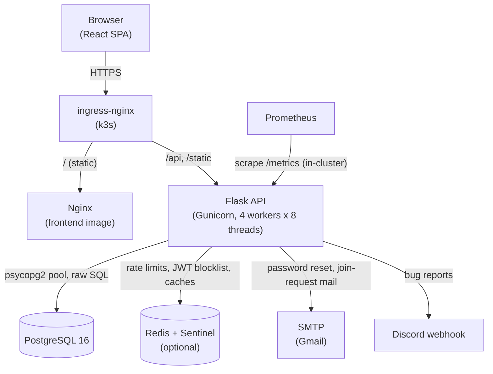

# Architecture

## Overview

The FMI{Codes} platform runs the operations layer of a 48-hour hackathon: participant registration, team formation, the registration queue, mentor/team preference collection, mentor matching and published results. It is a React single-page app talking to a Flask JSON API backed by PostgreSQL, with Redis as an optional accelerator. Code submission, team chat and live judging happen off-platform (public GitHub repos, Discord, an in-person jury).

## Component diagram



In production the cluster ingress routes `/api` and `/static` straight to the backend Service and everything else to the frontend. The frontend image's own `nginx.conf` also proxies `/api` and `/static` to `http://backend:5001`, which is how the Docker Compose stack works with the same image.

## Components

**Frontend** (`frontend/`). React 19 + TypeScript on Vite, Tailwind v4, React Router 7. Client rendered only. TanStack Query owns server state (30 s stale time, no retries, no refetch on focus). Two React contexts hold global state: `AuthContext` (current user, hydrated from `GET /api/auth/me` on load) and `ConfigContext` (feature flags from `GET /api/config`). All requests go through `src/lib/api.ts`, a fetch wrapper that sends cookies and broadcasts an `auth:unauthorized` window event on any 401 so `AuthContext` can clear the session. Role-gated pages wrap themselves in `RequireAuth roles={[...]}`; the route table in `App.tsx` is flat and unguarded.

**Backend** (`backend/`). Flask app factory in `app/__init__.py`. Layering is routes → services → database:

- `app/routes/`: four blueprints. `auth.py` (register, login, logout, me, password change and reset), `teams.py` (team lifecycle and join requests), `mentors.py` (mentor listing and preferences), `api_routes.py` (health, config, lookups, rankings, admin console, bug reports). Handlers validate input and delegate.
- `app/services/`: business logic. `team_service.py` (team mutations and the registration queue), `matching_service.py` (the matching algorithm), `mentor_selection_service.py` (preferences), `ranking_service.py`, `mentor_service.py` (mentor reads and JSON seed loaders), `auth_service.py` (bcrypt, JWT), `token_blocklist.py`, `redis_client.py`, `email_service.py`, `bug_report_service.py`, `regulations_service.py`.
- `app/utils/auth_decorators.py`: `token_required`, `participant_required`, `mentor_required`, `captain_required`, `admin_required`.
- `app/database.py`: a `ThreadedConnectionPool` per Gunicorn worker plus small helpers (`execute_query`, `execute_insert`, `get_db_cursor`). No ORM.

**PostgreSQL**. All durable state. `backend/database/schema.sql` is the authoritative schema; see [Data Model](data.md).

**Redis**. Optional everywhere. Used for Flask-Limiter storage (shared across workers), the JWT `jti` blocklist, and caches for hot public reads: seed universities and specialties (~1 h), mentor list (~30 min), team rankings (~60 s), registered teams (~30 s), regulations (~300 s) and the per-user revocation epoch (~45 s). Every cache that has a write path is invalidated by it after commit (seed loaders, mentor writes, score updates, and every team membership or registration change); the TTL is a safety net for missed or racing invalidations. `redis_client.py` picks Sentinel mode (`REDIS_SENTINELS` + `REDIS_MASTER_NAME`) over single-instance mode (`REDIS_URL`); with neither set Redis is disabled.

**Startup seeding**. Both `run_server.py` (dev) and `wsgi.py` (Gunicorn) load `universities.json`, `specialties.json` and `mentors.json` from `backend/database/seeds/` on every start. The loaders insert with `ON CONFLICT DO NOTHING`, so reruns are safe.

## Request flow

A captain accepting a join request, which is the busiest code path in the system:

```mermaid
sequenceDiagram
    participant SPA
    participant API as Flask (captain_required)
    participant Redis
    participant PG as PostgreSQL

    SPA->>API: POST /api/teams/requests/42/accept (cookie: token)
    API->>API: decode JWT (HS256)
    API->>Redis: EXISTS jti:blocked:<jti>
    API->>Redis: GET cache:epoch:participant:<id>
    API->>PG: SELECT is_captain, team_id FROM participants
    API->>PG: BEGIN; SELECT pg_advisory_xact_lock(1)
    API->>PG: lock request, team, applicant rows (FOR UPDATE)
    API->>PG: move applicant into team, mark request accepted
    API->>PG: invalidate applicant's other pending requests
    API->>PG: if team reached 3: status=active, register or queue
    API->>PG: COMMIT
    API-->>SPA: 200 {"success": true, ...}
```

Every operation that can change team membership or registration state takes the same transaction-scoped advisory lock (`pg_advisory_xact_lock(1)`), so the queue can never double-book a slot under a rush of concurrent joins.

## Team lifecycle and the registration queue

- Creating a team makes the creator its **captain** and generates an 8-character join code (`A-Z0-9`). New teams start as `pending`.
- A team becomes `active` when it reaches 3 members (`ACTIVE_THRESHOLD`) and caps at 6 (`MAX_TEAM_MEMBERS`).
- On activation the team is **registered** if fewer than 18 teams (`MAX_REGISTERED_TEAMS`) are registered, otherwise it gets the next `queue_position`.
- If a registered team drops below 3 members, or is disbanded, it is unregistered and the first active queued team is promoted.
- A captain leaving disbands the team.
- Admin manual register/unregister bypasses the auto rules. Manual unregister does **not** promote from the queue.

## Matching algorithm

Implemented in `backend/app/services/matching_service.py`. The goal is that every registered team ends up with **2 or 3 mentors, never more than 3**.

Inputs: active registered teams, active mentors, each captain's top-3 mentor ranking and each mentor's top-3 team ranking.

1. **Phase 1: mentor-proposing Gale-Shapley, many-to-many.** `TEAM_CAPACITY = 3` mentors per team and `MENTOR_CAPACITY = 3` teams per mentor. Mentors propose down their ranked list. A team with a free slot accepts. A full team compares the proposer against its worst current holder by the team's own ranking (unranked mentors rank last) and swaps if the proposer is better. Bumped mentors re-enter the queue.
2. **Phase 2: greedy fill.** Teams with the fewest mentors are processed first. Each is topped up to 3 with mentors that still have capacity, least-loaded first. These mentors may not appear in the team's ranking.

Warnings (non-blocking): teams or mentors that never submitted preferences, and teams left with fewer than 3 mentors because mentor capacity ran out. With 20 mentors x 3 slots there are 60 slots for 18 x 3 = 54 team seats, so a full event fills every team to 3.

`save_matching_results` replaces all rows in `team_mentors` under a separate advisory lock (`pg_advisory_xact_lock(2)`) and resets the confirmation flag. Teams and mentors keep seeing their own preferences until the admin calls `POST /api/admin/confirm-matching`. Running matching again after confirming silently un-confirms.

The algorithm core (`_run_algorithm`) is pure and has no Flask or DB dependencies, which is what `tests/test_matching.py` exercises.

## Auth and security model

- Three roles in the JWT payload: `participant`, `mentor`, `admin`. Login takes the role explicitly; participants and mentors are separate tables (separate credential spaces). The admin is a single credential from config (`ADMIN_EMAIL` + bcrypt `ADMIN_PASSWORD_HASH`), with `user_id` 0 in the token.
- Token transport: httpOnly `token` cookie, `SameSite=Lax`, `Secure` when `FLASK_ENV=production`. `Authorization: Bearer` is accepted as a fallback.
- Revocation is layered. Logout and password change put the `jti` in Redis with a TTL equal to the token's remaining life. Password change and reset also set `tokens_valid_from`, rejecting every older token for that user. Both checks fail open if Redis is down.
- Hardening present in code: bcrypt (12 rounds), timing-equalised login (a dummy hash runs when the account is missing), generic "already exists" registration errors, reset tokens stored only as SHA-256 hashes with a one-hour expiry, 12-character password minimum, HTML-injection characters rejected in name fields, 64 KB request body cap, per-route rate limits (register 10/min, login 15/min, reset request 5/h, default 200/min), production refuses to boot with weak or missing secrets.
- Security headers are added at the ingress layer (`security-headers` ConfigMap), not by Flask.

## Observability

`prometheus_flask_exporter` registers `/metrics` at the backend root. Prometheus scrapes it in-cluster through a ServiceMonitor; the public ingress deliberately does not route `/metrics`. Counters are per Gunicorn worker (not aggregated). Health probes: `GET /api/health` (liveness, touches nothing) and `GET /api/health/ready` (readiness: pooled `SELECT 1`, Redis reported but never gating). Details in the [runbook](runbook.md#7--observability-prometheus--grafana).

## Testing approach

Two layers, both pytest, plus a single frontend component test file:

- **Unit** (`tests/*.py`): app created with `create_app("testing")` and the DB pool patched out; services tested with mocked DB helpers. The matching algorithm is tested directly through its pure core.
- **API integration** (`tests/e2e/`): a real Flask app against a real PostgreSQL test database, driven through Flask's test client. Despite the folder name these are not browser tests.
- **Frontend** (`frontend/src/**/*.test.tsx`): Vitest + Testing Library. Not run in CI today.

No browser end-to-end tests exist. Full detail in [Testing](testing.md).

## Key decisions

Recorded as Architecture Decision Records in `docs/adr/`:

- [ADR-001](adr/001-raw-sql-no-orm.md): raw SQL with an authoritative `schema.sql`, no ORM, no migration runner.
- [ADR-002](adr/002-jwt-httponly-cookie-layered-revocation.md): JWT in an httpOnly cookie with Redis + epoch revocation.
- [ADR-003](adr/003-redis-optional-fail-open.md): Redis is optional and every use fails open.
- [ADR-004](adr/004-advisory-lock-registration-queue.md): one Postgres advisory lock serialises all registration-state changes.
- [ADR-005](adr/005-gale-shapley-plus-greedy-fill.md): many-to-many Gale-Shapley plus greedy fill for mentor matching.
- [ADR-006](adr/006-self-hosted-k3s-pull-based-gitops.md): self-hosted k3s with pull-based Flux GitOps and a manual prod gate.

## External dependencies

| Dependency                 | Used for                                              | Required                    |
| -------------------------- | ----------------------------------------------------- | --------------------------- |
| PostgreSQL 16              | All durable state                                     | Yes                         |
| Redis 7 (Sentinel in prod) | Rate-limit storage, JWT blocklist, caches             | No (degrades)               |
| SMTP (Gmail by default)    | Password reset links, join-request emails to captains | No (features silently fail) |
| Discord webhook            | Bug reports                                           | No                          |
| Docker Hub (`fssfmi/*`)    | Image registry                                        | For deploys                 |

## Known gaps

- No automated database backups; the Postgres PVC is the source of truth.
- The API contract is hand maintained on both sides; nothing generates or checks it.
- `/api/bug-report` ignores the auth cookie, so SPA reports are always anonymous.
- `GET /api/mentors/<id>/picture` raises on the string paths the seeder stores, so mentor photos on the team page never load.
- Admin MATCHING → EXPORT reads a field (`export`) the backend never returns, so the button does nothing.
- `POST /api/universities` and `POST /api/specialties` are unauthenticated.
- `hackathon_events` exists in the schema but nothing links teams to an event.
- `GET /api/ranking` (file-based legacy rankings) is not used by the frontend.
