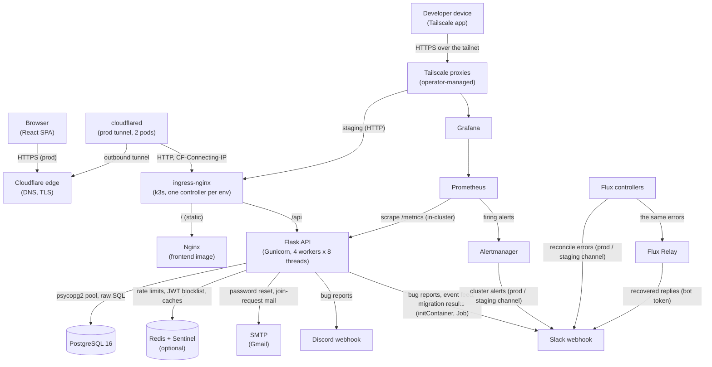

# Architecture

## Overview

The FMI{Codes} platform runs the operations layer of a 48-hour hackathon: participant registration, team formation, the registration queue, mentor/team preference collection, mentor matching and published results. It is a React single-page app talking to a Flask JSON API backed by PostgreSQL, with Redis as an optional accelerator. Code submission, team chat and live judging happen off-platform (public GitHub repos, Discord, an in-person jury).

## Component diagram



In production nothing on the server listens to the internet. `cloudflared` in the `fmi-codes` namespace holds an outbound Cloudflare Tunnel, on the one cluster given its credentials (`SERVE_PROD_TUNNEL=true`); Cloudflare terminates TLS for `fmicodes.com` with its edge certificate and sends each request down the tunnel, and `cloudflared` hands it as plain HTTP to prod's ingress-nginx, a `ClusterIP` Service ([ADR-017](adr/017-prod-through-cloudflare-tunnel.md)). The ingress routes `/api` straight to the backend Service and everything else, images included, to the frontend. Staging has its own ingress-nginx controller with the same routing and security headers, but no public entry: it is reached only over the `fss-fmi` tailnet, where a Tailscale proxy terminates TLS for `https://staging.<tailnet>.ts.net` and forwards to that controller ([ADR-009](adr/009-staging-over-tailscale.md)). The frontend image's own `nginx.conf` also proxies `/api` to `http://backend:5001`, which is how the Docker Compose stack works with the same image.

## Components

**Frontend** (`frontend/`). React 19 + TypeScript on Vite, Tailwind v4, React Router 7. Client rendered only. TanStack Query owns server state (30 s stale time, no retries, no refetch on focus except in `ConfigContext` and the new-version banner). Two React contexts hold global state: `AuthContext` (current user, read from the shared `['me']` query of `GET /api/auth/me` that every page uses through `useMe()`, so there is one copy; `RequireAuth` mounts it too, so opening a protected page refetches a stale user, and only a 401 or 404 signs the user out) and `ConfigContext` (feature flags and `MATCHING_CONFIRMED` from `GET /api/config`, refetched every 30 s and on window focus so a switch or a confirmation in Mission Control reaches open pages). All requests go through `src/lib/api.ts`, a fetch wrapper that sends cookies and broadcasts an `auth:unauthorized` window event on any 401 so `AuthContext` can clear the session (so an authenticated route answers a wrong input with 400, never 401). It throws an `ApiError` carrying the server's `error` text for a non-2xx answer and a `NetworkError` when none comes back; pages show either through `errorMessage()` in `src/lib/errors.ts`, which turns anything else, a bug in our own code, into a generic text. Role-gated pages wrap themselves in `RequireAuth roles={[...]}`; the route table in `App.tsx` is flat and unguarded. Every image, mentor photos included, lives in `frontend/public/` (photos and logos as WebP, the rest as SVG) and the frontend's nginx serves it, gzipping SVG, JS, CSS and JSON. Nginx caches Vite's hashed `/assets/` files as immutable, answers a missing one with 404, sends every other `/assets/` status as `no-store` and revalidates `index.html`; `public/asset-guard.js`, loaded before the bundle, reloads the page when a build file fails to load mid-rollout ([Rollouts](deployment.md#rollouts)). A build-only Vite plugin (`frontend/buildId.ts`) writes a hash of the bundle's file names and the build's time into `index.html` as `<meta name="build-id">`; open tabs fetch `/index.html` every 30 s and on window focus, and when it names a different build (a later one at once, an earlier one such as a rollback once two checks in a row serve it) a bottom-left card offers RELOAD (`NewVersionBanner`). `tests/test_site_images.py` holds each image to a size budget and fails on missing or unused images.

**Backend** (`backend/`). Flask app factory in `app/__init__.py`. Layering is routes → services → database:

- `app/routes/`: four blueprints. `auth.py` (register, login, logout, me, password change and reset, email verification), `teams.py` (team lifecycle and join requests), `mentors.py` (mentor listing and preferences), `api_routes.py` (health, config, lookups, rankings, admin console including the feature flag switches, bug reports). Handlers validate input and delegate.
- `app/services/`: business logic. `team_service.py` (team mutations, the registration queue and the admin's member edits), `matching_service.py` (the matching algorithm, the admin's mentor edits and `frozen_locked`, the freeze check), `mentor_selection_service.py` (preferences, from registered teams and active mentors only), `matching_events.py` (event feed messages for the matching phase), `ranking_service.py`, `mentor_service.py` (mentor reads and JSON seed loaders), `auth_service.py` (bcrypt, JWT), `token_blocklist.py`, `redis_client.py`, `email_service.py`, `bug_report_service.py`, `regulations_service.py`, `feature_flag_service.py` (registration, preference submission, rankings and roster switches, with schedules), `event_notifier.py` (the Slack event feed).
- `app/utils/auth_decorators.py`: `token_required`, `participant_required`, `mentor_required`, `captain_required`, `admin_required`.
- `app/utils/hash_slots.py`: the per-pod cap on concurrent password hashes, shedding the rest with a 429 ([ADR-016](adr/016-shed-password-hashes.md)).
- `app/utils/rate_limits.py` (the limiter's key functions and limits, [ADR-014](adr/014-rate-limits-keyed-on-account-and-user.md)), `fail_open_limiter.py` (the limiter's switch to memory when Redis fails, [ADR-003](adr/003-redis-optional-fail-open.md)), `request_json.py` (typed JSON body and field readers that answer a wrong type with 400) and `slack.py` (escapes user text so it cannot become a Slack link or mention).
- `app/database.py`: a `ThreadedConnectionPool` per Gunicorn worker plus small helpers (`execute_query`, `execute_insert`, `get_db_cursor`). Every checkout pings its connection (`SELECT 1`, the first statement of the caller's transaction) and replaces a dead one, so a Postgres restart costs no request once Postgres is back. Every connection, the migration runner's too, has a 5 s connect timeout, keepalives (30 s idle, then 10 s probes) and a 10 s `tcp_user_timeout`, and Postgres sets the same TCP values on its side. So when a peer goes silent (packets dropped, no reset), a query still being sent fails in 10 s instead of the kernel's 15 or so minutes, one already sent and waiting on its reply (a wait on advisory lock 1, say) fails in about 40 s instead of about 2 h (libpq's default keepalives on the OS timers), and a vanished client's locks, advisory lock 1 included, are freed in about 40 s instead of about 2 h once its session waits on the client (a statement already running finishes first, then its reply times out in 10 s). A slow query or a lock wait is never cut short: a live peer acknowledges at once. No ORM.

**PostgreSQL**. All durable state. `backend/database/schema.sql` is the authoritative schema; numbered migrations bring existing databases up to date and are recorded in `schema_migrations`. See [Data Model](data.md).

**Redis**. Optional everywhere. Used for Flask-Limiter storage (shared across workers; a list of timestamps per limit and key under `LIMITS-MOVING:`, one per request accepted in the last window), the JWT `jti` blocklist, and caches for hot public reads: seed universities and specialties (~1 h), mentor list (~30 min), team rankings (~60 s), registered teams (~30 s), regulations (~300 s), the per-user revocation epoch (~45 s) and the feature flags and the matching confirmation (~10 s under a versioned key that every switch, confirm and confirmation-clearing run bumps, never past a pending schedule's time). Every cache that has a write path is invalidated by it after commit (seed loaders, score updates, flag switches and schedules, and every team membership or registration change), and the migration runner deletes every `cache:*` key after it applies anything; the TTL is a safety net for missed or racing invalidations. `redis_client.py` picks Sentinel mode (`REDIS_SENTINELS` + `REDIS_MASTER_NAME`) over single-instance mode (`REDIS_URL`); with neither set Redis is disabled. A Redis outage only turns off what Redis provides ([ADR-003](adr/003-redis-optional-fail-open.md)). Every connection has a 0.5 s timeout and no retries. The app's calls go through a circuit breaker per process that skips Redis for 5 s after a connection error or timeout, then lets one call try again. The limiter keeps the same limits in each worker's memory until Redis answers its ping again.

**Startup seeding**. Both `run_server.py` (dev) and `wsgi.py` (Gunicorn) load `universities.json` and `specialties.json` from `backend/database/seeds/` on every start, then the mentor seed `MENTORS_SEED_FILE` names. Mentors are personal data, so the real seed is kept out of the tree and the image build: development and testing default to the fake `mentors.dev.json`, and in the cluster it is a SOPS-encrypted Secret per env, mounted into the backend (production config has no default and seeds nobody without it, [ADR-018](adr/018-mentor-seed-in-sops-secret.md)). The loaders insert with `ON CONFLICT DO NOTHING`, so reruns are safe. The mentor insert names no conflict target, so a duplicate on any of its unique keys is a no-op and the workers that seed at the same moment on a fresh database never collide. A mentor entry with a blank email or phone or an unknown status is skipped with a warning, and so is one that shares only its email, or only its name and company, with a stored mentor (seeding never changes a stored mentor). New mentors get their email stored lowercased, as login matches it, and a mentor seeded without a password can't log in until they set one through forgot password.

## Request flow

A captain accepting a join request, which is the busiest code path in the system:

```mermaid
sequenceDiagram
    participant SPA
    participant API as Flask (captain_required)
    participant Redis
    participant PG as PostgreSQL

    SPA->>API: POST /api/teams/requests/42/accept (cookie: token)
    API->>API: decode JWT (HS256)
    API->>Redis: EXISTS jti:blocked:<jti>
    API->>Redis: GET cache:epoch:participant:<id>
    API->>PG: SELECT is_captain, team_id FROM participants
    API->>PG: BEGIN; SELECT pg_advisory_xact_lock(1)
    API->>PG: lock request, team, applicant rows (FOR UPDATE)
    API->>PG: move applicant into team, mark request accepted
    API->>PG: invalidate applicant's other pending requests
    API->>PG: if team reached 3: status=active, register or queue
    API->>PG: COMMIT
    API-->>SPA: 200 {"success": true, ...}
```

Every operation that can change team membership or registration state takes the same transaction-scoped advisory lock (`pg_advisory_xact_lock(1)`), so the queue can never double-book a slot under a rush of concurrent joins.

**Lock order** ([ADR-019](adr/019-freeze-teams-on-confirmed-matching.md)). Every transaction that takes lock 1 reads `matching_state ... FOR SHARE` (`frozen_locked`) as its very next statement, before any row lock, which is also how it learns whether teams are frozen. The two preference saves read it first, before their flag check and their team or mentor row lock. The writers of `team_mentors`, a matching save and an admin mentor edit, take `pg_advisory_xact_lock(2)` and then `matching_state ... FOR UPDATE` before touching that table. An insert into `team_mentors` takes a key-share lock on its `teams` row through the foreign key, so without this a lock-1 transaction holding a team row `FOR UPDATE` and then deleting that team's assignments could deadlock against a save; with `matching_state` first, all of them queue on one row.

## Team lifecycle and the registration queue

- Creating a team makes the creator its **captain** and generates an 8-character join code (`A-Z0-9`). New teams start as `pending`.
- A team becomes `active` when it reaches 3 members (`ACTIVE_THRESHOLD`) and caps at 6 (`MAX_TEAM_MEMBERS`).
- On activation the team is **registered** if fewer than 18 teams (`MAX_REGISTERED_TEAMS`) are registered, otherwise it gets the next `queue_position`.
- If a registered team drops below 3 members, or is disbanded, it is unregistered and the first active queued team that has its 3 members is promoted (one the admin took below 3 while matching was confirmed stays queued, and takes a free slot itself when it gets back to 3 and is first in line).
- Every unregister, automatic or by the admin, deletes the team's `team_mentors` rows in the same transaction.
- A captain leaving disbands the team.
- Admin manual register/unregister bypasses the auto rules. Manual unregister does **not** promote from the queue.
- **The freeze.** Once matching is confirmed, the server refuses every participant change to a team's members (create, join, apply, leave, remove, disband, accept) and both preference saves with 403; decline and cancel stay open. The admin's escape hatch is Mission Control's TEAMS tab: add a member by email, remove one (handing captaincy to another member when it is the captain; an admin removal never disbands), and replace a registered team's mentors. After confirmation nothing moves a slot by itself: a team below 3 keeps its slot and stays `active`, nobody is promoted, and a pending team reaching 3 is activated and joins the end of the queue, never a slot. A team taken below 3 keeps its slot after a re-run too, until the admin unregisters it. A new run clears the confirmation and lifts the freeze ([ADR-019](adr/019-freeze-teams-on-confirmed-matching.md)).

## Matching algorithm

Implemented in `backend/app/services/matching_service.py`. The goal is that every registered team ends up with **2 or 3 mentors, never more than 3**.

Inputs: active registered teams, active mentors, each captain's top-3 mentor ranking and each mentor's top-3 team ranking.

1. **Phase 1: mentor-proposing Gale-Shapley, many-to-many.** `TEAM_CAPACITY = 3` mentors per team and `MENTOR_CAPACITY = 3` teams per mentor. Mentors propose down their ranked list. A team with a free slot accepts. A full team compares the proposer against its worst current holder by the team's own ranking (unranked mentors rank last) and swaps if the proposer is better. Bumped mentors re-enter the queue.
2. **Phase 2: greedy fill.** First an even fill: one mentor at a time goes to the team with the fewest mentors, from the least-loaded mentors that still have capacity and aren't on it yet, until no team under 3 can take another. A shortage therefore spreads across teams instead of leaving the last ones empty. Then a rebalance for when phase 1 already used up every mentor slot: while a team has fewer than 2 mentors and another has 3, a full team hands one mentor to the shortest team, the one it wants least: a mentor it didn't rank before a ranked one, then its largest rank, then a mentor who didn't rank it. After each move the even fill runs again, since the donor, now at 2, may take a mentor who still has room. Mentors added here may not appear in the team's ranking. Ties go by team and mentor id, which the run reads in order, so the same data always gives the same result.

Warnings (non-blocking): teams or mentors that never submitted preferences, teams left with fewer than 3 mentors because mentor capacity ran out, and teams left with fewer than 2. Every team reaches 2 whenever there are at least 2 active mentors and 3 x mentors >= 2 x teams (12 mentors for 18 teams). With 20 mentors x 3 slots there are 60 slots for 18 x 3 = 54 team seats, so a full event fills every team to 3.

`save_matching_results` replaces all rows in `team_mentors` under a separate advisory lock (`pg_advisory_xact_lock(2)`, then `matching_state FOR UPDATE`, see the lock order above) and resets the confirmation flag. It writes only the pairs whose team is still active and registered, since the run read its teams outside any transaction. The admin export reads under the same key, shared, so all its reads come from one saved run. Teams and mentors keep seeing their own preferences until the admin calls `POST /api/admin/confirm-matching`, and until then the API shows the assignments only to the admin: `GET /api/teams/<id>` returns no mentors to anyone else and `GET /api/mentors/assigned-teams` no teams, each reading the flag in the same statement as the assignments. Every read of assignments also skips teams that aren't registered. Confirming freezes teams and preferences; the admin's later mentor edits (`PUT /api/admin/teams/<id>/mentors`) keep the confirmation and may go past 3 per team or 3 teams per mentor with a warning. Running matching again after confirming un-confirms, lifts the freeze and replaces the hand edits; Mission Control's run and confirm dialogs warn about it, and the event feed mentions it.

Each step of the phase is posted to the event feed after its commit: a ranking submitted (with the progress count) or updated, a matching run (assignment and team counts plus the warnings), a confirmation (only when it changes the flag) and each admin edit in the TEAMS tab or unregister that released mentors. The messages name who acted and give counts, never a ranking, a rank or a team-mentor pair. A mentor counts as submitted only while at least one of their picks is still a registered active team. A failing count or Slack hand-off is logged and never changes the response.

The algorithm core (`_run_algorithm`) is pure and has no Flask or DB dependencies, which is what `tests/test_matching.py` exercises.

## Auth and security model

- Three roles in the JWT payload: `participant`, `mentor`, `admin`. Login takes the role explicitly; participants and mentors are separate tables (separate credential spaces). The admin is a single credential from config (`ADMIN_EMAIL` + bcrypt `ADMIN_PASSWORD_HASH`), with `user_id` 0 in the token.
- Token transport: httpOnly `token` cookie, `SameSite=Lax`, `Secure` when `FLASK_ENV=production`. `Authorization: Bearer` is accepted as a fallback.
- Revocation is layered. Logout and password change put the `jti` in Redis with a TTL equal to the token's remaining life. Password change and reset also set `tokens_valid_from`, rejecting every older token for that user. Both checks fail open if Redis is down.
- Hardening present in code: bcrypt (12 rounds), timing-equalised login (a dummy hash runs when the account is missing, and an admin login hashes whatever the email), generic "already exists" registration errors, reset and email-verification tokens stored only as SHA-256 hashes (one-hour and 24-hour expiry), optional email-verification gate on team create/join/apply (`REQUIRE_EMAIL_VERIFICATION`), 12-character password minimum, HTML-injection characters rejected in name fields, 64 KB request body cap, rate limits keyed on what they protect ([ADR-014](adr/014-rate-limits-keyed-on-account-and-user.md): login 15 attempts per minute per account (the admin's too), cleared by a successful login; reset requests 5/h per email; the 200/min default per signed-in user; address limits, from the one `X-Forwarded-For` hop the trusted proxy sets (`ProxyFix`; on prod ingress-nginx sets it from Cloudflare's `CF-Connecting-IP`, trusted only from the pod network), are ceilings sized for a whole venue behind one NAT address: register and login 300/min, anonymous default 3000/min per route and 6000/min across routes; all multiplied by `RATELIMIT_MULTIPLIER`, which is 10 on staging; every limit counts on a moving window, so no burst gets past it at a window's edge and slots free one at a time; a 429 carries `Retry-After`, which the login and registration pages wait out with up to 3 s of jitter and retry up to 3 times; health probes and the polled `/api/config` and `/api/teams/rankings` exempt), production refuses to boot with weak or missing secrets, team scores withheld from the API until `rankings_live` is on.
- Overload sheds instead of queueing ([ADR-016](adr/016-shed-password-hashes.md)). Every bcrypt call runs inside one of the pod's hash slots: its CPU limit in whole cores (prod 3, staging 1), shared by its workers as `flock` lock files (`app/utils/hash_slots.py`). With none free a request waits up to 2 s in one of two waiting slots per hash slot, or with no waiting slot free is answered at once: 429 `The server is busy. Wait a moment and try again.` with `Retry-After: 2`, before anything is written, which the login and registration pages wait out and retry like a rate limit. The hashes a booting worker runs (the login timing dummy, the mentor seed) are never shed. Readiness drops a pod after 2 min of misses and liveness restarts it after 5, so overload, which reaches every pod at once, never drops or restarts them all.
- Security headers are added at the ingress layer (`security-headers` ConfigMap), not by Flask.

## Observability

`prometheus_flask_exporter` registers `/metrics` at the backend root. Prometheus scrapes it in-cluster through a ServiceMonitor; the public ingress deliberately does not route `/metrics`. Gunicorn's workers share their metrics through files in `PROMETHEUS_MULTIPROC_DIR` (`backend/gunicorn.conf.py`), so every scrape returns the whole pod's totals. `password_hash_shed_total{reason}` counts the hashes shed past the pod's cap (`waiting_room_full`, `wait_timeout`), and `mail_sent_total{kind, result}` every email the backend tried to send (`sent`, `failed` or `skipped` without SMTP credentials). The two FMI Grafana dashboards are the screen for the registration rush ([Event day](runbook/event-day.md)). Health probes (left out of the request metrics): `GET /api/health` (liveness, touches nothing) and `GET /api/health/ready` (readiness: pooled `SELECT 1`, Redis reported but never gating). One kube-prometheus-stack serves both environments and depends on neither. Grafana is reachable only over the `fss-fmi` Tailscale tailnet: the Tailscale operator serves its Ingress as `https://grafana.<tailnet>.ts.net`, bypassing ingress-nginx ([ADR-008](adr/008-grafana-over-tailscale.md)). Alertmanager (in the same stack) and Flux's notification-controller post failures inside the cluster, such as crash-looping pods, failed Jobs, stuck rollouts, reconcile errors and a prod tunnel with no connection to Cloudflare (`CloudflareTunnelDown`), to Slack through incoming webhooks: staging's namespace and Flux objects to `#cluster-alerts-staging`, everything else to the channel of the env the cluster serves (`#cluster-alerts-prod` on the server) ([ADR-010](adr/010-cluster-alerts-to-slack.md)). The Flux Relay in `flux-system` gets the same Flux errors, watches each failing object's `Ready` condition and, once it recovers, replies in the error's thread and reacts ✅ on every post of the incident ([ADR-012](adr/012-flux-recovery-replies.md)). Details in the [runbook](runbook/index.md#7--observability-prometheus--grafana).

## Testing approach

Two layers, both pytest, plus a few frontend tests and a load test:

- **Unit** (`tests/*.py`): app created with `create_app("testing")` and the DB pool patched out; services tested with mocked DB helpers. The matching algorithm is tested directly through its pure core.
- **API integration** (`tests/e2e/`): a real Flask app against a real PostgreSQL test database, driven through Flask's test client. Despite the folder name these are not browser tests.
- **Frontend** (`frontend/src/**/*.test.{ts,tsx}`): Vitest + Testing Library.
- **Load** (`tests/load/`): the registration rush, 500 users registering and forming teams in the first minute, run by hand as a Job on staging. It fails with an exit code on the pass criteria, and SQL files check and clean the database after.

No browser end-to-end tests exist. Full detail in [Testing](testing.md).

## Key decisions

Recorded as Architecture Decision Records in `docs/adr/`:

- [ADR-001](adr/001-raw-sql-no-orm.md): raw SQL with an authoritative `schema.sql`, no ORM.
- [ADR-002](adr/002-jwt-httponly-cookie-layered-revocation.md): JWT in an httpOnly cookie with Redis + epoch revocation.
- [ADR-003](adr/003-redis-optional-fail-open.md): Redis is optional and every use fails open.
- [ADR-004](adr/004-advisory-lock-registration-queue.md): one Postgres advisory lock serialises all registration-state changes.
- [ADR-005](adr/005-gale-shapley-plus-greedy-fill.md): many-to-many Gale-Shapley plus greedy fill for mentor matching.
- [ADR-006](adr/006-self-hosted-k3s-pull-based-gitops.md): self-hosted k3s with pull-based Flux GitOps and a manual prod gate.
- [ADR-007](adr/007-recorded-migrations-runner.md): recorded migrations, applied by a backend initContainer on every rollout and on demand by a backed-up Job.
- [ADR-008](adr/008-grafana-over-tailscale.md): one shared Grafana, reached only over a Tailscale tailnet.
- [ADR-009](adr/009-staging-over-tailscale.md): staging reached only over the tailnet, in front of its own ingress-nginx.
- [ADR-010](adr/010-cluster-alerts-to-slack.md): Alertmanager and Flux post in-cluster failures to a prod and a staging Slack channel through webhooks.
- [ADR-011](adr/011-one-tailscale-client-staging.md): every cluster, prod's included, uses staging's Tailscale OAuth client, so a prod machine needs the staging age key too.
- [ADR-012](adr/012-flux-recovery-replies.md): a relay in `flux-system` replies "recovered" in the thread of a Flux error once the object is ready again, with its own Slack app and Secret.
- [ADR-013](adr/013-feature-flags-in-database.md): registration, preference submission, rankings and the mentor roster are rows in `feature_flags`, switched or scheduled from Mission Control with no restart, each change posted to the event feed.
- [ADR-014](adr/014-rate-limits-keyed-on-account-and-user.md): rate limits key on the account a login or reset names and on the signed-in user; client-address limits are only ceilings sized for a venue behind one NAT address.
- [ADR-015](adr/015-rolling-surge-rollouts.md): rollouts surge one pod at a time with none unavailable and drain stopping pods behind a `preStop` sleep, not blue-green, which would break the Postgres connection budget.
- [ADR-016](adr/016-shed-password-hashes.md): a per-pod cap on concurrent password hashes sheds the rest with a 429 instead of queueing them, and probes wait 2 and 5 min before they drop or restart a busy pod.
- [ADR-017](adr/017-prod-through-cloudflare-tunnel.md): prod is reached only through a Cloudflare Tunnel run in the cluster, with Cloudflare's certificate and the visitor's address from `CF-Connecting-IP`; nothing on the server listens to the internet.
- [ADR-018](adr/018-mentor-seed-in-sops-secret.md): the mentor seed is personal data, so it lives only in a SOPS-encrypted Secret per env that the backend mounts; production has no default seed and no default mentor password.
- [ADR-019](adr/019-freeze-teams-on-confirmed-matching.md): confirmed matching freezes participant team changes and preferences; the admin edits members and mentors by hand in the TEAMS tab, and every writer of `team_mentors` locks `matching_state` first.
- [ADR-020](adr/020-main-only-secret-environments.md): the Slack and Docker Hub secrets live in environments only `main` can use, reviews reach the PR feed through a secretless relay workflow and `.github/` changes need the code owner's review; the bot app key waits for #313.

## External dependencies

| Dependency                    | Used for                                                                                                  | Required                                  |
| ----------------------------- | --------------------------------------------------------------------------------------------------------- | ----------------------------------------- |
| PostgreSQL 16                 | All durable state                                                                                         | Yes                                       |
| Redis 7 (Sentinel)            | Rate-limit storage, JWT blocklist, caches                                                                 | No (degrades)                             |
| SMTP (Gmail by default)       | Verification links, password reset links, join-request emails to captains                                 | No (features silently fail)               |
| Discord webhook               | Bug reports                                                                                               | No                                        |
| Slack (webhooks + bot tokens) | Bug reports, event feed, migration results, PR feed, CI alerts, cluster alerts and their recovery replies | No                                        |
| Docker Hub (`fssfmi/*`)       | Image registry                                                                                            | For deploys                               |
| Cloudflare (free plan)        | `fmicodes.com` DNS, the edge TLS certificate and the tunnel into prod                                     | For prod                                  |
| Tailscale (`fss-fmi` tailnet) | Developer access to Grafana and staging                                                                   | No (both only via `kubectl port-forward`) |

## Known gaps

- No automated database backups; the Postgres PVC is the source of truth.
- The API contract is hand maintained on both sides; nothing generates or checks it.
- `hackathon_events` exists in the schema but nothing links teams to an event.
- `GET /api/ranking` (file-based legacy rankings) is not used by the frontend.
- The staging bump gate only protects `main` when its run succeeds. If a run fails while a half bump sits on a bump PR that already has auto-merge on, the mixed pair can merge. Rare (it needs a GitHub or token outage at that moment) and handled by hand; see the [runbook](runbook/index.md#6--gitops-continuous-deploy-flux-opt-in).
