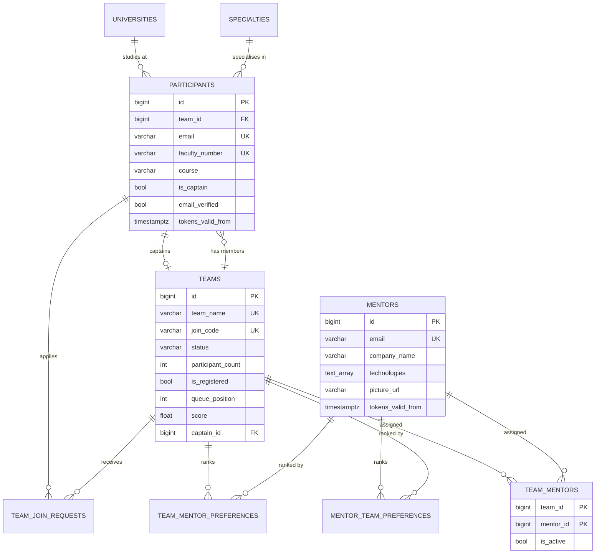

# Data Model

## Overview

One PostgreSQL 16 database (`fmi_hackathon_2026` in prod, `fmi_hackathon_2026_staging` in staging, `fmi_hackathon_2026_dev` by default locally). Twelve tables, four views, three trigger functions and one data-quality function, all defined in `backend/database/schema.sql`. The backend talks to it with psycopg2 and hand-written SQL; there is no ORM.

Domains:

- **People**: `participants`, `mentors` (separate credential spaces; the admin has no row).
- **Teams**: `teams`, `team_join_requests`.
- **Matching**: `team_mentor_preferences`, `mentor_team_preferences`, `team_mentors`, `matching_state`.
- **Lookups**: `universities`, `specialties`.
- **Auth support**: `password_reset_tokens`, `email_verification_tokens`.
- **Unused**: `hackathon_events` (seeded with one row, nothing references it from code).

## ER diagram

## Tables

### teams

| Column               | Type                       | Notes                                                                                                                       |
| -------------------- | -------------------------- | --------------------------------------------------------------------------------------------------------------------------- |
| `id`                 | bigserial PK               |                                                                                                                             |
| `team_name`          | varchar(100) unique        | Validated against HTML characters on create                                                                                 |
| `password_hash`      | varchar(255) not null      | Legacy column. Always written as `''` and stripped from API responses                                                       |
| `join_code`          | varchar(20) unique         | 8 chars `A-Z0-9`, generated on create                                                                                       |
| `status`             | varchar(20)                | `pending` (under 3 members), `active` (3 or more), `completed`, `disqualified`. Only `pending` and `active` are set by code |
| `participant_count`  | int                        | Denormalised; maintained by the `trig_update_participant_count` trigger on `participants.team_id` changes                   |
| `is_registered`      | bool                       | Holds one of the 18 event slots                                                                                             |
| `registered_at`      | timestamptz                | Set when registered; drives display order                                                                                   |
| `queue_position`     | int                        | 1-based waiting list position; null when not queued                                                                         |
| `score`              | double precision           | Final judged score, 0 to 100, entered by the admin                                                                          |
| `score_updated_at`   | timestamptz                |                                                                                                                             |
| `captain_id`         | bigint FK participants     | `ON DELETE SET NULL`                                                                                                        |
| `hackathon_event_id` | bigint FK hackathon_events | Never set by code                                                                                                           |

Trigger `trig_prevent_team_deletion` blocks deleting a team that still has active participants, which is why disbanding first detaches every member.

### participants

| Column                          | Type                | Notes                                                                                       |
| ------------------------------- | ------------------- | ------------------------------------------------------------------------------------------- |
| `id`                            | bigserial PK        |                                                                                             |
| `team_id`                       | bigint FK teams     | `ON DELETE RESTRICT`; null when teamless                                                    |
| `first_name`, `last_name`       | varchar(100)        |                                                                                             |
| `email`                         | varchar(255) unique | Stored lowercased                                                                           |
| `phone_number`                  | varchar(20)         |                                                                                             |
| `faculty_number`                | varchar(20) unique  |                                                                                             |
| `course`                        | varchar(30)         | CHECK: `Bachelor 1st Year` .. `Bachelor 4th Year`, `Masters 1st Year` .. `Masters 6th Year` |
| `specialty_id`, `university_id` | bigint FK           | `ON DELETE RESTRICT`                                                                        |
| `password_hash`                 | varchar(255)        | bcrypt                                                                                      |
| `is_captain`                    | bool                |                                                                                             |
| `status`                        | varchar(20)         | `active`, `inactive`, `removed`. Only active participants can log in or count toward teams  |
| `tokens_valid_from`             | timestamptz         | Session revocation epoch; any JWT with an earlier `iat` is rejected                         |
| `email_verified`                | bool                | Default false for new rows. Rows that existed before migration 016 were set to true         |
| `password_reset_requested_at`   | timestamptz         | Unused by current code                                                                      |

### mentors

| Column                                    | Type                | Notes                                                                                             |
| ----------------------------------------- | ------------------- | ------------------------------------------------------------------------------------------------- |
| `id`                                      | bigserial PK        |                                                                                                   |
| `first_name`, `last_name`, `company_name` | varchar             | Unique together (`uidx_mentors_identity`), used as the seed upsert key                            |
| `email`                                   | varchar(255) unique |                                                                                                   |
| `phone_number`                            | varchar(20)         |                                                                                                   |
| `bio`, `availability_text`                | text                |                                                                                                   |
| `technologies`                            | text[]              | GIN indexed                                                                                       |
| `picture_url`                             | varchar(500)        | A path such as `/static/mentorPictures/alice.jpg` (files in `backend/app/static/mentorPictures/`) |
| `picture_filename`                        | varchar(255)        |                                                                                                   |
| `password_hash`                           | varchar(255)        | bcrypt                                                                                            |
| `status`                                  | varchar(20)         | `active`, `inactive`, `archived`. Only active mentors appear, log in or get matched               |
| `tokens_valid_from`                       | timestamptz         | Same meaning as for participants                                                                  |

### team_join_requests

One row per (participant, team) pair; re-applying reopens the row. `status`: `pending`, `accepted`, `declined`, `invalidated` (applicant joined another team, or the team was disbanded), `cancelled` (withdrawn by the applicant).

### team_mentor_preferences / mentor_team_preferences

A captain's ranking of mentors and a mentor's ranking of teams. Rank is 1 to 3, unique per owner, and the pair is the primary key. The API always replaces all three rows at once.

### team_mentors

Matching output. Primary key (`team_id`, `mentor_id`), `is_active` (always true when written), `assigned_at`, `notes` (unused). Every matching run deletes all rows and writes a fresh set. The goal is 2 or 3 rows per team and never more than 3.

### matching_state

A single row (`id = 1`, enforced by CHECK). `is_confirmed` flips to true when the admin confirms; every new matching run resets it.

### password_reset_tokens

`user_id` + `role` (`participant` or `mentor`), `token_hash` (SHA-256 hex of the emailed token; the raw token is never stored), `expires_at` (one hour), `used_at`. Requesting a new link deletes the user's unused tokens. Nothing prunes expired rows yet.

### email_verification_tokens

`participant_id` (FK participants, `ON DELETE CASCADE`), `token_hash` (SHA-256 hex, unique; the raw token is never stored), `expires_at` (24 hours), `used_at`. Registration and every resend delete the participant's unused tokens before inserting a new one. Nothing prunes expired rows yet.

### universities / specialties

`name` unique. `is_seed = true` marks the curated list the registration dropdown shows; user-submitted "Other" entries are stored with `is_seed = false`.

## Views and functions

| Object                          | Purpose                                                               |
| ------------------------------- | --------------------------------------------------------------------- |
| `v_teams_summary`               | Teams with mentor count and mentor companies                          |
| `v_participants_full`           | Participants joined with specialty, university and team               |
| `v_mentors_assignments`         | Mentors with active team counts and names                             |
| `v_teams_participant_breakdown` | Bachelor/Masters split per team                                       |
| `check_data_consistency()`      | Reports teams under 3 or over 6 members and unassigned active mentors |

None of these are used by the application; they are for manual SQL inspection.

## Seed data

Loaded by both `run_server.py` and `wsgi.py` on every start (idempotent, `ON CONFLICT DO NOTHING`):

| File                                       | Rows | Loaded into                                                                                                                       |
| ------------------------------------------ | ---- | --------------------------------------------------------------------------------------------------------------------------------- |
| `backend/database/seeds/universities.json` | 41   | `universities` (`is_seed = true`)                                                                                                 |
| `backend/database/seeds/specialties.json`  | 18   | `specialties` (`is_seed = true`)                                                                                                  |
| `backend/database/seeds/mentors.json`      | 20   | `mentors`. Password defaults to `mentor123` when an entry has none; bare picture filenames become `/static/mentorPictures/<file>` |

Read at request time (not stored in the DB):

| File                                                     | Served by                                      |
| -------------------------------------------------------- | ---------------------------------------------- |
| `backend/database/seeds/regulations.json` (13 Q&A pairs) | `GET /api/regulations`                         |
| `backend/database/seeds/rankings.json` (21 rows)         | `GET /api/ranking` (legacy, unused by the SPA) |

`schema.sql` also inserts 6 universities, 8 specialties and one `hackathon_events` row of its own.

## Schema management

- `backend/database/schema.sql` is the authoritative, current schema. Fresh environments apply it directly: Postgres `initdb` runs it in Docker Compose and k3s (mounted as `01_schema.sql` / the `postgres-initdb` ConfigMap), and the e2e test fixture applies it once per session.
- `backend/database/migrations/NNN_name.sql` are deltas for databases created before those changes. `python -m database.migrate` (from `backend/`) applies every file not yet recorded in `schema_migrations`, in number order, each in its own transaction with its record ([ADR-007](adr/007-recorded-migrations-runner.md)). On k3s it runs automatically as the backend's initContainer on every rollout, and on demand through **Actions → Migrate database** (see [Deployment](deployment.md#database-migrations)).
- Rules for a migration file: the next unused three-digit number, lowercase name (`017_add_x.sql`), safe to re-run (`IF NOT EXISTS`, `ON CONFLICT`, ...), and no `BEGIN`/`COMMIT`. `tests/test_migrate.py` enforces the naming and transaction rules; the e2e suite applies every file against a fresh `schema.sql` database.
- `schema_migrations` (`filename` primary key, `applied_at`) is created by the runner, not by `schema.sql`. The first run on a database that predates it re-applies 012 to 016 as no-ops and records them.
- `016_email_verification.sql` adds `participants.email_verified` with `DEFAULT TRUE` (so existing participants are grandfathered as verified) and then switches the default to false for new rows. It is safe to re-run, and `schema.sql` uses the same two statements.
- Most statements use `IF NOT EXISTS`, but the `CREATE TRIGGER` statements do not, so running `schema.sql` a second time against an existing database fails partway. Treat it as a create-once script.
- On k3s the schema and DB password are baked into the Postgres PVC at first boot. Editing `schema.sql` does not migrate a running database.

## Concurrency rules

- Every change to team membership or registration state runs inside one transaction that first takes `pg_advisory_xact_lock(1)`, then row-locks what it touches with `SELECT ... FOR UPDATE`.
- Saving matching results takes `pg_advisory_xact_lock(2)`, a separate key so it never contends with team mutations.
- Preference writes lock the owning team or mentor row so a double submit cannot interleave.
- UNIQUE constraints (email, faculty number, team name, join code, join request pair) are the final guard against races.

## Backups

None are automated. The Postgres PVC is the source of truth on the cluster.
