# Deployment

How a change gets from a merged PR to staging and `fmicodes.com`, and how to verify, configure and roll back. This page is the operator summary. Standing up a cluster from a bare server, secrets, observability and teardown live in the full **[cluster runbook](runbook/index.md)**.

## Environments

|           | Production                       | Staging                                                     |
| --------- | -------------------------------- | ----------------------------------------------------------- |
| URL       | https://fmicodes.com             | `https://staging.<tailnet>.ts.net` (`fss-fmi` tailnet only) |
| Namespace | `fmi-codes`                      | `fmi-codes-staging`                                         |
| Entry     | Cloudflare Tunnel                | Tailscale proxy                                             |
| TLS       | Cloudflare's edge certificate    | The Tailscale proxy's certificate                           |
| Deploys   | Manual promote (human-merged PR) | Automatic after every merge to `main`                       |
| Database  | `fmi_hackathon_2026`             | `fmi_hackathon_2026_staging`                                |

Both run on one self-hosted single-node k3s server, built from the same `infra/k8s/base/` with Kustomize overlays. Probes, the frontend (2 replicas), the backend's memory, its connection pool and feature-flag defaults are identical by design. The differences are deliberate. Prod is sized for the registration rush (#219): its backend runs 4 pods, each requesting 1 CPU and allowed up to 3 (`overlays/prod/backend-capacity-patch.yaml`), against staging's 2 pods at 100m and 1 (whole cores on both, so each pod gets one hash slot per core and staging sheds load the way prod does, [ADR-016](adr/016-shed-password-hashes.md)); its Postgres allows 250 connections with a 1-CPU request, no CPU limit and 2Gi, against staging's 150 and 1Gi; and its ingress controller requests 500m CPU. And `RATELIMIT_MULTIPLIER`: staging's rate limits are 10 times prod's, because every anonymous staging visitor shares one address bucket behind the Tailscale proxy. Staging is reached only from a device on the tailnet; its Tailscale proxy forwards to staging's own ingress-nginx, so requests take prod's path through the security headers and routing ([ADR-009](adr/009-staging-over-tailscale.md), [access details](runbook/tailscale.md#access-grafana-and-staging)). Prod opens no port either: `cloudflared` in the cluster holds an outbound tunnel to Cloudflare, which serves `fmicodes.com` with its own certificate and passes the visitor's address on in `CF-Connecting-IP` ([ADR-017](adr/017-prod-through-cloudflare-tunnel.md), [setup](runbook/cloudflare.md#set-up-the-tunnel)). Cloudflare only forwards to whatever the cluster runs, so the release flow below is unchanged.

## Release flow

```mermaid
graph LR
    PR["PR merged to main"] --> CD["docker-cd.yaml<br/>build + push images"]
    CD --> Hub[("Docker Hub<br/>fssfmi/fmi-codes-*")]
    Hub --> Flux["Flux (in cluster)<br/>polls every 5m"]
    Flux --> Bump["commit tag bump<br/>to flux-image-updates"]
    Bump --> AutoPR["flux-auto-pr.yaml<br/>PR + auto-merge"]
    AutoPR --> Staging["staging redeploys"]
    Staging --> Promote["promote-to-prod.yaml<br/>(manual dispatch)"]
    Promote --> ProdPR["PR: prod overlay tags"]
    ProdPR -->|human merge| Prod["prod redeploys"]
```



1. **Build.** On push to `main`, `.github/workflows/docker-cd.yaml` builds `backend/` and `frontend/` and pushes `fssfmi/fmi-codes-backend` and `fssfmi/fmi-codes-frontend` tagged `latest` and `<unix-timestamp>-<short-sha>`. Pushes that only touch `infra/**` or documentation (`docs/**`, any `.md`, `mkdocs.yml`, the docs workflow) skip the build. It also runs on manual dispatch from `main` (its Docker Hub credentials sit in the `main`-only `dockerhub` environment, so other branches are refused, per [Secrets only `main` can use](github-automation.md#secrets-only-main-can-use)) and on the 1st of every month. Each image keeps its own GitHub Actions build cache (`scope=backend`, `scope=frontend`), so unchanged dependency layers are reused and a deploy pulls only the layer with the changed app files; the monthly run builds without the cache, so base images and the unpinned (`>=`) Python dependencies refresh at least once a month.
2. **Staging bump.** Flux's `ImagePolicy` picks the highest timestamp tag and rewrites the `$imagepolicy`-marked tags in `infra/k8s/overlays/staging/kustomization.yaml`, pushing the commit to the `flux-image-updates` branch.
3. **Auto-merge.** `.github/workflows/flux-auto-pr.yaml` opens (or reuses) a PR from `flux-image-updates` to `main` as the `fmi-codes-bot` GitHub App and enables auto-merge, so the bump squash-merges by itself once `main`'s required checks (Unit & E2E tests, Lint, Frontend tests) pass. It does this only once the backend and frontend tags on the branch match: the two images are pushed about a minute apart, so a Flux scan can bump one before the other exists. Until the next scan bumps the second, no PR opens and auto-merge is off on any open bump PR, so `main` (and with it staging and the next promote) never holds a mixed pair. The repo must have "Allow auto-merge" turned on; if auto-merge can't be enabled the workflow fails instead of leaving the bump unmerged. Setup of the app: [GitHub automation](github-automation.md#github-bot-app-for-automated-prs); the gate: [runbook](runbook/index.md#6--gitops-continuous-deploy-flux-opt-in).
4. **Staging deploys.** Flux reconciles the merged overlay.
5. **Promote to prod.** Run **Actions → Promote to production**. Leave the inputs blank to promote whatever tags staging runs now, or pass specific tags (must match `<ts>-<sha>`). The workflow writes the tags into `infra/k8s/overlays/prod/kustomization.yaml` on a `promote-to-prod` branch and opens a PR.
6. **Human gate.** Merging that PR is the only way prod changes. The prod overlay has no `$imagepolicy` markers, so Flux can never move it on its own.

`docker-cd.yaml` ignores `infra/**` so the Flux bump commits do not trigger new builds in a loop. Keep build inputs (Dockerfiles, build scripts) in `backend/` and `frontend/`.

## Rollouts

An image bump, a restart or a config change rolls the backend and the frontend one pod at a time, built to drop no request ([ADR-015](adr/015-rolling-surge-rollouts.md)):

- **Capacity never drops.** Both Deployments set `maxSurge: 1` and `maxUnavailable: 0`: a new pod starts next to the old ones, and one old pod stops only once the new one passes readiness. Prod's backend steps through its 4 pods one at a time (staging's 2 took about 30 s), so the scripts that restart the backend wait up to 300 s for it.
- **Stopping pods drain.** A stopping pod first sleeps 10 s (`preStop`) and keeps serving, so the ingress has dropped it from its endpoints before its server stops listening. Then Gunicorn finishes the requests in flight within `graceful_timeout` (30 s), inside the backend's 45 s grace period, and nginx stops gracefully on `SIGQUIT`. Without the sleep, requests that reached a stopping frontend pod on staging waited about 5 s (ingress-nginx's connect timeout, then a retry on another pod), and a POST already sent to a stopping backend pod is not retried (#267).
- **Two versions serve at once for a few seconds.** The frontend and the backend roll independently, and within each one old and new pods both serve until the last old pod stops.
  - Old backend pods run on the migrated schema, because the migrate initContainer runs before the first new pod starts. Every migration has to work with the previous release's code ([Schema management](data.md#schema-management)).
  - A new SPA can briefly call an endpoint the old backend doesn't have yet. Ship a new endpoint before the page that needs it, or let the page tolerate a 404.
  - A page from one frontend version can ask a pod running the other for its hashed bundle, which isn't there. Nginx answers 404 (never `index.html`), and `frontend/public/asset-guard.js`, loaded before the bundle, reloads the page after 2 s, waiting 2 s longer on each try, at most 5 times per tab. `index.html` and the guard are sent with `Cache-Control: no-cache` and the hashed `/assets/` files as immutable, so a browser never keeps a page that names files no longer deployed. Every other `/assets/` answer, the 404 included, is `no-store`, so neither a browser nor Cloudflare replays it after the rollout.
  - A tab that loaded fine keeps running the old JS after the rollout. Every 30 s and on window focus it fetches `/index.html` and reads the `<meta name="build-id">` there: a hash of the bundle's file names and the build's time. When the hash differs from its own, a bottom-left card offers RELOAD: at once for a later build, and for an earlier one (a rollback) once two checks in a row serve it. × hides the card until another build is served. A tab that loaded the new build from a new pod and then reaches an old one sees an earlier build only for the few seconds of the rollout, so it shows nothing, and a card already showing stays. When the server serves the tab's own code again, the card goes away. The hash changes only when the built JS or CSS does: a backend-only push and a rebuild of the same code (the monthly one) show no card. Files in `public/` aren't part of the hash, but Tailwind scans every text file under `frontend/` for class names, `public/` included, so an edit to the README, a comment, a test or a `public/` file can change the CSS once it ships with the next build (a push that changes only `.md` files doesn't build) and show a harmless card. The first rollout that ships this can't warn tabs opened before it. A rollout stuck with old and new pods both serving can show a card that RELOAD doesn't clear for good.
  - On a rollout to or from a frontend image from before #267 (the first one that ships this, or a rollback past it), the older pods answer a missing `/assets/` file (or `/asset-guard.js`) with a cacheable `index.html`. A browser, and Cloudflare in front of prod ([ADR-017](adr/017-prod-through-cloudflare-tunnel.md)), can keep that for days, so a page caught mid-rollout can stay blank through reloads until a hard reload or the next frontend release. Take prod's first promote that carries this before prod serves visitors; if it already does, purge Cloudflare's cache after the rollout ([ADR-015](adr/015-rolling-surge-rollouts.md)).
- **Don't roll out prod during the registration rush.** The connection budget (`tests/test_capacity_budget.py`) counts the surge pod plus one old pod still draining. Under heavy load a draining pod can hold its pool for the whole 40 s while new pods keep stepping in about every 15 s, so three can drain at once: on prod that is 8 pods, 266 connections against 250 ([runbook](runbook/index.md#2--stateful-tier-postgres--redis-sentinel)). What to check before the opening, who watches what and when to act: [Event day](runbook/event-day.md).

## Database migrations

Pending migrations ship inside the backend image and are applied two ways ([ADR-007](adr/007-recorded-migrations-runner.md)):

- **Automatically on every rollout.** The backend Deployment's `migrate` initContainer runs `python -m database.migrate` before the new pods start. It posts to Slack only when it applied something or failed. If a migration fails, the new pods stay in `Init` and the old ones keep serving. It also runs whenever a backend pod restarts (node reboot, k3s restart), so it waits up to 60 s for Postgres to accept connections. If Postgres stays unreachable for that minute, the initContainer only logs it and exits, and the pod goes into `CrashLoopBackOff` (`kubectl -n <namespace> logs <pod> -c migrate`); it does not post, because every replica and every restart would post the same error. A "migration run failed" message from a rollout therefore means a real error after connecting. The manual Job below still posts every result, an unreachable database included.
- **Caches after a migration.** Either way, once a run applies anything the runner deletes every `cache:*` key in Redis (the logout blocklist, rate-limit keys and the feature-flag version counter stay), so the next request reads the migrated rows. The log says `Cleared N Redis cache key(s)`. Both get `REDIS_PASSWORD` from the `fmi-codes-redis` Secret; if Redis is down the migration still succeeds and the caches expire on their TTLs (the mentor list after up to about 30 minutes).
- **On demand, with a backup.** Run **Actions → Migrate database** with:
  - `environment`: `staging` or `prod`.
  - `image_tag`: the backend image whose migrations to apply. Blank means the tag live in staging, which is what the next promote would ship.

  It renders `infra/k8s/templates/db-migrate-job.yaml` into `overlays/<env>/db-migrate-job.yaml` (through `infra/k8s/scripts/render-migrate-job.sh`) on a `migrate-<env>` branch and opens a PR listing the migrations in that image. A staging PR merges itself once the required checks pass, since dispatching the run is the approval; a prod PR waits for you to merge it. Flux then runs Job `db-migrate-<run>`: `pg_dump` into the `db-migration-backups` PVC (last 5 kept, nothing is migrated if the dump fails), then the runner, then a Slack message with the result and the backup file.

For a prod release that carries a migration, run **Migrate database** for `prod` with the tag you are about to promote, merge it, wait for the Slack result, then promote. The initContainer would apply it anyway, but only the manual Job takes a backup first.

Like the promote PR, the migration PR is opened by the `fmi-codes-bot` GitHub App, so CI runs on it normally; merging a prod one stays a human decision. Each run replaces the previous `db-migrate-<run>` Job in the overlay, and Flux prunes the old Job and its pod, so at most one finished migration Job per environment stays in the cluster with nothing to clean up by hand. A failed Job leaves the app Flux Kustomization not ready until the next migration run replaces the Job; read it with `kubectl -n <namespace> logs job/db-migrate-<run> --all-containers`.

## Build artifacts

| Image                       | Built from                                                                                                            | Runs                                                                                                                                                                           |
| --------------------------- | --------------------------------------------------------------------------------------------------------------------- | ------------------------------------------------------------------------------------------------------------------------------------------------------------------------------ |
| `fssfmi/fmi-codes-backend`  | `backend/Dockerfile` (python:3.12-slim)                                                                               | `gunicorn --config gunicorn.conf.py wsgi:app` (:5001, 4 workers x 8 threads) as UID 10001                                                                                      |
| `fssfmi/fmi-codes-frontend` | `frontend/Dockerfile` (node:22-alpine build with `npm ci` from the committed `package-lock.json`, nginx:alpine serve) | Nginx on :80 as UID 101, SPA fallback (404 under `/assets/`), gzip, immutable `/assets/` and `no-cache` `index.html` ([Rollouts](#rollouts)), proxies `/api` to `backend:5001` |

## Configuration

| Kind                                                                                                                                                                                                                                                   | Where                                                                                                                                                                                                     | Change it with                                                                                                                                                                                                     |
| ------------------------------------------------------------------------------------------------------------------------------------------------------------------------------------------------------------------------------------------------------ | --------------------------------------------------------------------------------------------------------------------------------------------------------------------------------------------------------- | ------------------------------------------------------------------------------------------------------------------------------------------------------------------------------------------------------------------ |
| Non-secret config (`FLASK_ENV`, `DB_*` with `DB_POOL_MAX`, `REDIS_SENTINELS`, `REDIS_MASTER_NAME`, `REDIS_URL`, `FRONTEND_ORIGIN` (prod only), `REQUIRE_EMAIL_VERIFICATION`, `RATELIMIT_MULTIPLIER`)                                                   | ConfigMap `fmi-codes-backend-config`: `infra/k8s/base/app/backend.yaml` (prod's values), overridden for staging in `infra/k8s/overlays/staging/backend-config-patch.yaml`                                 | Edit the YAML and merge it, then `bash infra/k8s/scripts/apply-config.sh` applies `main` and restarts the backend ([how](runbook/index.md#change-a-config-value))                                                  |
| App secrets (`SECRET_KEY`, `JWT_SECRET_KEY`, `ADMIN_PASSWORD_HASH`, `MAIL_PASSWORD`, `DISCORD_BUG_WEBHOOK_URL`, `SLACK_BUG_WEBHOOK_URL`, `SLACK_MIGRATIONS_WEBHOOK_URL`, `SLACK_EVENTS_WEBHOOK_URL` and on staging `FRONTEND_ORIGIN`, its tailnet URL) | SOPS-encrypted `infra/k8s/secrets/secrets.enc.yaml` (prod) and `infra/k8s/overlays/staging/secrets/secrets.enc.yaml`                                                                                      | `bash infra/k8s/scripts/rotate-secret.sh <KEY>` (prompts for the value; see [Rotate a secret](runbook/secrets.md#rotate-a-secret)), then commit the `.enc.yaml`                                                    |
| Mentor seed (the roster with emails, phones and any starting passwords; personal data, so kept out of the tree and the image)                                                                                                                          | SOPS-encrypted Secret `fmi-codes-mentors-seed`: `infra/k8s/secrets/mentors-seed.enc.yaml` (prod) and `infra/k8s/overlays/staging/secrets/mentors-seed.enc.yaml`, mounted where `MENTORS_SEED_FILE` points | `sops <file>`, commit it, then `deploy-app.sh` and a backend restart ([how](runbook/secrets.md#mentor-seed)). Seeding only inserts new mentors                                                                     |
| DB and Redis passwords                                                                                                                                                                                                                                 | Generated in-cluster by `deploy-stateful.sh`, tied to the PVC                                                                                                                                             | `bash infra/k8s/scripts/rotate-datastore-password.sh <target>` with `db`, `db-admin` or `redis` ([how](runbook/secrets.md#db-and-redis-passwords)); never delete the Secret and PVC to rotate, that wipes the data |

### Feature flags during the event

Registration, preference submission, the mentor roster and the rankings are switched by the admin in Mission Control (**SITE** tab, see the [User Guide](user-guide.md#site-tab)), with no deploy, config change or restart. Each can be switched now or scheduled for a time, and every change is posted to the environment's event feed in Slack (`SLACK_EVENTS_WEBHOOK_URL`: `#event-feed-prod` or `#event-feed-staging`). The values live in the `feature_flags` table ([Data Model](data.md#feature_flags), [ADR-013](adr/013-feature-flags-in-database.md)), so staging and prod are switched independently and a Flux reconcile never reverts them.

| Flag                 | Turn on when                   | Effect                                                                                                                              |
| -------------------- | ------------------------------ | ----------------------------------------------------------------------------------------------------------------------------------- |
| `registration_open`  | Registration window opens      | Enables `/api/auth/register` and the REGISTER link                                                                                  |
| `preferences_open`   | Ranking window opens           | Enables both ranking POSTs (403 while off) and the ranking pages' edit flow; close it at the deadline before the final matching run |
| `mentors_stay_tuned` | Mentor roster is not final yet | `/mentors` shows "MENTORS COMING SOON" instead of the roster                                                                        |
| `rankings_live`      | Results go public              | `/rankings` shows the live leaderboard instead of the placeholder; API returns scores (admin-only until then)                       |

Every flag starts off on a new database, and migration 020 adds `preferences_open` off, so after that deploy nobody can rank until the admin opens it. On the first prod promote that carries 020, open **PREFERENCE SUBMISSIONS** right after the rollout if ranking should already be open; the migration posts nothing to the event feed. The API enforces a change on the next request in every pod. Visitors who already have the site open see it within 30 seconds (the SPA polls `/api/config`). A scheduled change takes effect within a few seconds of its time, on the first request after it; the database clock decides.

`REQUIRE_EMAIL_VERIFICATION` is still server config, because it depends on SMTP working rather than on an event moment:

| Flag                         | Turn on when                 | Effect                                                            |
| ---------------------------- | ---------------------------- | ----------------------------------------------------------------- |
| `REQUIRE_EMAIL_VERIFICATION` | SMTP is confirmed to deliver | Unverified participants get 403 on create, join and apply to team |

Staging and prod are switched independently. For staging, set it in `infra/k8s/overlays/staging/backend-config-patch.yaml`. For prod, set it in `infra/k8s/base/app/backend.yaml`, which staging inherits, so also pin staging's current value (`"false"` until its `MAIL_PASSWORD` is set) in staging's patch. Merge it, then apply `main` and restart the backend:

```bash
ENV=prod bash infra/k8s/scripts/apply-config.sh
```

Before turning on `REQUIRE_EMAIL_VERIFICATION`, register a test account and confirm the verification email arrives. With SMTP broken nobody could verify, and so nobody could form a team. On an existing database, apply `backend/database/migrations/016_email_verification.sql` first.

Flux applies git every 5 minutes and puts back any live change, so on a Flux cluster `apply-config.sh REQUIRE_EMAIL_VERIFICATION true` refuses. To turn it off before a fix can merge (SMTP broke mid-event), suspend Flux for that env first; [Change a config value](runbook/index.md#change-a-config-value) has the steps. Staging is the default env; pass `ENV=prod` for prod.

### Environment variables

The complete list with defaults is `.env.example` (local) plus the ConfigMap and Secret above (cluster). Variables with no safe default:

| Variable                                              | Required    | Notes                                                                                                                                                                                                                                     |
| ----------------------------------------------------- | ----------- | ----------------------------------------------------------------------------------------------------------------------------------------------------------------------------------------------------------------------------------------- |
| `SECRET_KEY`                                          | yes         | Production refuses to start if missing or a known dev value                                                                                                                                                                               |
| `JWT_SECRET_KEY`                                      | yes         | Same check                                                                                                                                                                                                                                |
| `ADMIN_PASSWORD_HASH`                                 | yes         | bcrypt hash; production refuses to start without it                                                                                                                                                                                       |
| `DB_PASSWORD`                                         | yes         | From the `fmi-codes-db` Secret on the cluster                                                                                                                                                                                             |
| `FRONTEND_ORIGIN`                                     | yes in prod | CORS origin and the base of password-reset and verification links                                                                                                                                                                         |
| `MAIL_PASSWORD`                                       | no          | Without it reset, verification and join-request emails are skipped                                                                                                                                                                        |
| `DISCORD_BUG_WEBHOOK_URL`                             | no          | Discord webhook for bug reports                                                                                                                                                                                                           |
| `SLACK_BUG_WEBHOOK_URL`                               | no          | Slack incoming webhook for bug reports, used alongside Discord; with neither set bug reports are dropped                                                                                                                                  |
| `SLACK_MIGRATIONS_WEBHOOK_URL`                        | no          | Slack incoming webhook for migration results; without it they are only logged                                                                                                                                                             |
| `SLACK_EVENTS_WEBHOOK_URL`                            | no          | Slack incoming webhook for the event feed (feature flag changes, ranking submissions, matching runs and confirmation), one channel per environment; without it events are only logged                                                     |
| `REDIS_SENTINELS` + `REDIS_MASTER_NAME` / `REDIS_URL` | no          | Without them rate limits are per-process and token revocation is off                                                                                                                                                                      |
| `RATELIMIT_MULTIPLIER`                                | no          | Multiplies every rate limit. Default 1 (prod), 10 on staging. Anything but a positive whole number refuses to boot                                                                                                                        |
| `MENTORS_SEED_FILE`                                   | no          | Mentor seed JSON loaded on every start. Development and testing default to the fake `backend/database/seeds/mentors.dev.json`; production has no default and seeds nobody without it. The Deployment points it at the mounted seed Secret |
| `HASH_SLOTS`                                          | no          | Password hashes a pod runs at once ([ADR-016](adr/016-shed-password-hashes.md)). The Deployment sets it to the CPU limit in cores; unset means no cap. A bad value refuses to boot                                                        |

## Health checks

| Endpoint                | Probe                | Healthy response                                             |
| ----------------------- | -------------------- | ------------------------------------------------------------ |
| `GET /api/health`       | liveness and startup | 200 `{"status": "ok"}`                                       |
| `GET /api/health/ready` | readiness            | 200 `{"db": "ok", "redis": "ok"}`; 503 when Postgres is down |

Probes wait for a Gunicorn thread like any request, and overload reaches every backend pod at once, so they give a busy pod time ([ADR-016](adr/016-shed-password-hashes.md)): each request gets 10 s, readiness drops a pod from the Service after 2 min of misses and liveness restarts it after 5. Password hashes past a pod's cap get a fast 429 instead of queueing, which keeps threads free for the probes during the registration rush. A pod that stays unready for minutes is broken, not busy: check `kubectl -n <namespace> describe pod` and its logs before restarting it.

```bash
kubectl -n fmi-codes get pods
curl https://fmicodes.com/api/health
curl https://staging.<tailnet>.ts.net/api/health/ready   # from a tailnet device
flux get kustomizations -n flux-system
```

After any deploy also confirm the two invariants from the runbook: a push to `main` moved staging but not prod, and the two databases stay separate.

## Rollback

- **Production:** `git revert` the promote PR's merge commit (or open a new promote run with the previous tags) and merge. Flux redeploys the old images.
- **Every rollback is a rollout.** It drains and mixes versions like any other (see [Rollouts](#rollouts)), and the older code runs on the current schema, which is why migrations have to stay backward compatible. Open tabs show the new-version card within about a minute, since an earlier build needs two checks in a row.
- **Staging:** revert the Flux bump commit on `main`. Flux will bump forward again on the next build, so fix forward if the bad commit is still the newest.
- **Database:** image rollbacks do not touch data, and migrations have no down scripts. Undo a migration with a new forward migration, or restore the `pg_dump` the manual migration Job took (see [Restore a migration backup](runbook/index.md#restore-a-migration-backup)). There are no off-site backups.

## Monitoring

Self-hosted kube-prometheus-stack in the `monitoring` namespace scrapes both app namespaces with 14-day retention. Grafana provisions "FMI Production" and "FMI Staging" dashboards (request rate, latency percentiles, 5xx share, 429s by route, register and login p95, hash sheds, backend CPU and throttling, pod readiness and restarts, emails sent, node CPU) and is reachable only over the `fss-fmi` Tailscale tailnet (`kubectl -n monitoring get ingress grafana` shows its address). Logs: `kubectl -n fmi-codes logs -f deploy/backend`. Setup and access details: [runbook section 7](runbook/index.md#7--observability-prometheus--grafana).

## Local production-like run

```bash
docker compose -f docker-compose.yml up -d
```

Pulls the published `latest` images, runs Postgres and Redis Sentinel and serves the app on port 80. Useful to rehearse a Redis failover before touching the cluster. With `FLASK_ENV=development` from `.env.example` it seeds the fake mentors from `mentors.dev.json`; with `production` it seeds none unless `MENTORS_SEED_FILE` points at a file inside the container.
