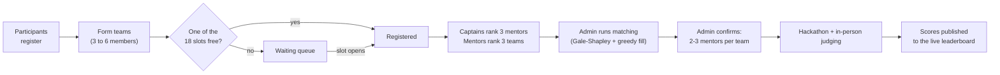

# FMI{Codes} 2026

FMI{Codes} is a 48-hour student hackathon. This platform runs everything around the coding itself: participant registration, team formation, the limited event slots and their waiting queue, mentor and team preferences, mentor matching and the published results. Code lives in public GitHub repos, team chat happens on Discord and judging is done by an in-person jury.

One web app serves three kinds of users:

| Role            | What they do on the platform                                                                             |
| --------------- | -------------------------------------------------------------------------------------------------------- |
| **Participant** | Registers, creates or joins a team, and (as captain) manages the team and ranks mentors                  |
| **Mentor**      | Is onboarded by the organizers, publishes a profile, ranks teams and sees the teams they are assigned    |
| **Admin**       | Runs Mission Control: manages registration slots, runs and confirms mentor matching, enters final scores |

## How the event flows

1. **Registration.** Participants sign up while `REGISTRATION_OPEN` is on.
2. **Teams.** The creator of a team becomes its captain and gets a join code. Others join with the code or apply through BROWSE TEAMS. A team becomes active at 3 members and caps at 6.
3. **Slots and queue.** The first 18 active teams are registered automatically. Later teams wait in a numbered queue and are promoted when a registered team drops out.
4. **Preferences.** Each captain ranks exactly 3 mentors and each mentor ranks exactly 3 registered teams.
5. **Matching.** The admin runs a two-phase matching that gives every team 2 or 3 mentors, never more than 3, then confirms it so teams and mentors see their assignments.
6. **Results.** After judging, the admin enters each team's score (0 to 100) and the rankings page shows the live leaderboard once `RANKINGS_LIVE` is on.

## Stack at a glance

| Layer          | Technology                                                                            |
| -------------- | ------------------------------------------------------------------------------------- |
| Frontend       | React 19, TypeScript, Vite, Tailwind CSS v4, React Router 7, TanStack Query           |
| Backend        | Flask 3 on Python 3.12, Gunicorn in production, raw SQL through psycopg2 (no ORM)     |
| Data           | PostgreSQL 16 (all durable state), Redis with Sentinel (optional, fails open)         |
| Infrastructure | Self-hosted single-node k3s, Kustomize overlays for staging and prod, SOPS secrets    |
| Delivery       | GitHub Actions builds images, Flux GitOps deploys staging, prod via a human-merged PR |
| Observability  | Prometheus and Grafana (kube-prometheus-stack), self-hosted                           |

## Where to go next

| If you want to                                       | Read                                          |
| ---------------------------------------------------- | --------------------------------------------- |
| Run the platform locally and ship your first change  | [Getting Started](onboarding.md)              |
| Use the site as a participant, mentor or organizer   | [User Guide](user-guide.md)                   |
| Understand the components, request flow and matching | [Architecture](architecture.md)               |
| See the database schema, seeds and concurrency rules | [Data Model](data.md)                         |
| Call or change an API endpoint                       | [API Reference](api.md)                       |
| Know why things are built the way they are           | [Decision Records](adr/001-raw-sql-no-orm.md) |
| Write or run tests                                   | [Testing](testing.md)                         |
| Release to staging and prod, configure, roll back    | [Deployment](deployment.md)                   |
| Stand up or operate the k3s cluster from scratch     | [Cluster Runbook](runbook.md)                 |
| Look up a domain term (captain, queue, assignment)   | [Glossary](glossary.md)                       |

## Repository

The source is at [github.com/fss-fmi/fmi-codes-website-2026](https://github.com/fss-fmi/fmi-codes-website-2026). Every page on this site is a Markdown file in `docs/`; use the edit icon at the top of a page to propose a change.
